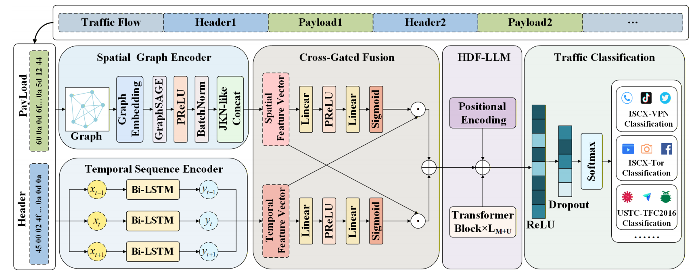

# LLM4ETC: Classifying encrypted traffic via spatial-temporal feature fusion in large language models

PyTorch implementation of **LLM4ETC: Classifying encrypted traffic via spatial-temporal feature fusion in large language models**.

LLM4ETC combines packet-header sequences and byte-level payload graphs through cross-gated fusion, then adapts a pretrained GPT-2 backbone to learn global spatial-temporal traffic representations.



The implemented path is header Bi-LSTM and payload GraphSAGE → cross-gated fusion → 256-to-768 projection → six GPT-2 blocks → temporal mean pooling → two fully connected layers. HDF retains the existing final-block attention and LayerNorm tuning rule; FFNs remain frozen.

## Environment Setup

Create a Python environment, install PyTorch and DGL builds compatible with your CUDA version, and install the remaining dependencies:

```bash
python -m venv .venv
source .venv/bin/activate
python -m pip install torch dgl
python -m pip install -r requirements.txt
```

On Windows, activate the environment with `.venv\Scripts\activate`. Select compatible PyTorch, DGL, and CUDA versions for GPU use; a default package installation does not guarantee CUDA support. The pretrained `gpt2` weights must be downloaded or available in the Transformers cache.

## Datasets

The implementation provides configurations for the following datasets and traffic subsets:

| Dataset / subset | CLI name | Classes | Local directory |
| --- | --- | ---: | --- |
| ISCX-VPN2016: VPN | `iscx-vpn` | 6 | `data/ISCX-VPN/` |
| ISCX-VPN2016: NonVPN | `iscx-nonvpn` | 6 | `data/ISCX-NonVPN/` |
| ISCX-Tor2016: Tor | `iscx-tor` | 8 | `data/ISCX-Tor/` |
| ISCX-Tor2016: NonTor | `iscx-nontor` | 8 | `data/ISCX-NonTor/` |
| USTC-TFC2016 | `ustc-tfc2016` | 20 | `data/USTC-TFC2016/` |
| CESNET-QUIC22 | `cesnet-quic22` | 75 | `data/CESNET-QUIC22/` |

Obtain the datasets separately. Class names, label mappings, and directory examples for **the five original configurations** are listed in [Dataset Preparation](docs/DATASETS.md). The `DATA/` directory contains empty categorization templates; packet captures and trained checkpoints are not included.

## Pre-processing

### 1. Prepare bidirectional flows

Split captures into bidirectional TCP flows using a flow-splitting tool such as SplitCap. Place each per-flow `.pcap` in the class directory defined by `DIR_PATH_DICT` in `config.py`. The converter extracts packet data; it does not split captures into flows. `pcapng2pcap.py` is an optional format-conversion utility.

Paths default to the repository's `data/` and `checkpoints/` directories. To use different locations:

```bash
export ST_LLM_DATA_ROOT=/absolute/path/to/data
export ST_LLM_CHECKPOINT_ROOT=/absolute/path/to/checkpoints
```

### 2. Extract packet bytes

Run the command for the selected dataset:

```bash
python pcap2npy.py --dataset iscx-vpn
python pcap2npy.py --dataset iscx-nonvpn
python pcap2npy.py --dataset iscx-tor
python pcap2npy.py --dataset iscx-nontor
python pcap2npy.py --dataset ustc-tfc2016
```

Each command extracts header and payload sequences into per-flow `.npz` files. Existing files with the same filename stem are skipped.

### 3. Construct traffic graphs

Use the same dataset name for preprocessing:

```bash
python preprocess.py --dataset iscx-vpn
python preprocess.py --dataset iscx-nonvpn
python preprocess.py --dataset iscx-tor
python preprocess.py --dataset iscx-nontor
python preprocess.py --dataset ustc-tfc2016
```

The script creates paired header arrays, payload PMI graphs, identities and a split manifest. LLM4ETC consumes header arrays and payload graphs; headers and payloads use identical retained packet indices.

## Training

After preprocessing, train the model on the selected dataset:

```bash
python train.py --dataset iscx-vpn --cuda 0
python train.py --dataset iscx-nonvpn --cuda 0
python train.py --dataset iscx-tor --cuda 0
python train.py --dataset iscx-nontor --cuda 0
python train.py --dataset ustc-tfc2016 --cuda 0
```

Each command is an independent experiment. Choose the relevant command rather than running every dataset. Add `--seed 32` to select a run seed or `--save_path checkpoints/custom.pth` to choose a checkpoint path.

## Evaluation

Evaluate the saved checkpoint using the matching dataset configuration:

```bash
python test.py --dataset iscx-vpn --cuda 0
python test.py --dataset iscx-nonvpn --cuda 0
python test.py --dataset iscx-tor --cuda 0
python test.py --dataset iscx-nontor --cuda 0
python test.py --dataset ustc-tfc2016 --cuda 0
```

For a custom checkpoint, add `--checkpoint /path/to/model.pth`. Evaluation reports per-class precision, recall, and F1.

## Reproducibility and reviewer experiments

See the [Experiment Guide](docs/EXPERIMENTS.md) for complete commands and input schemas. New data must be regenerated with paired packet selection and sample/source IDs; old untracked caches are rejected. Existing datasets retain the per-class test rule; training/validation now uses source groups targeting half the samples to prevent related-flow leakage. CESNET uses Week 1 for training, Week 2 for validation and Weeks 3–4 for separate tests.

```bash
python build_cesnet.py --input candidates.csv --classes classes.txt --output cesnet.csv
python preprocess.py --dataset cesnet-quic22 --manifest cesnet.csv
python run_seeds.py --dataset iscx-vpn --cuda 0 --variant hdf
python run_seeds.py --dataset iscx-vpn --cuda 0 --variant no-pretrain
python run_seeds.py --dataset iscx-vpn --cuda 0 --variant full-tuning
```

Ten-seed runs now save independent test metrics, predictions and sample IDs, and aggregate test means/sample standard deviations separately from validation summaries. `compare_runs.py` checks pairing and computes two-sided paired t-tests, 95% confidence intervals and Holm-adjusted p-values. `benchmark.py` measures synchronized forward-pass batch latency, actual samples/s, peak allocated/reserved CUDA memory, and parameter counts. Full GPU execution and historical result reproduction have not been verified in the editing environment; no scores are hard-coded.

See [Reproducibility Notes](docs/REPRODUCIBILITY.md) and [Manuscript Alignment](docs/ALIGNMENT.md) for defaults, migration requirements and remaining response-letter corrections.

## Repository Structure

| Path | Purpose |
| --- | --- |
| `config.py` | Dataset mappings, paths, and model/training configuration |
| `model.py` | Header encoder, payload GraphSAGE, cross-gated fusion, GPT-2, and classifier |
| `pcap2npy.py`, `preprocess.py` | Packet extraction and traffic graph construction |
| `dataloader.py`, `utils.py` | Dataset loading, collation, and processing utilities |
| `train.py`, `test.py` | Training and evaluation |
| `training_settings.py` | Effective run metadata and learning-rate schedule |
| `run_seeds.py` | Repeated training plus independent test metrics and summaries |
| `build_cesnet.py`, `paired_data.py`, `packet_input.py` | Manifest selection, shared packet selection and packet input |
| `evaluation.py`, `compare_runs.py` | Checkpoint evaluation and paired statistical comparisons |
| `benchmark.py` | CUDA latency, throughput, memory and parameter measurements |
| `DATA/` | Empty class categorization templates |
| `docs/` | Dataset and reproducibility details |

## License

This project is distributed under the Apache License 2.0. See [LICENSE](LICENSE) for details.
